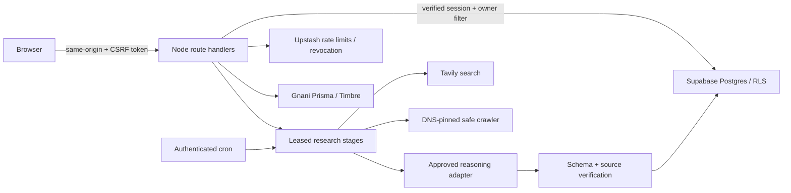

# Architecture

Spectra is a Next.js App Router application with server-side authentication and provider access. React renders text safely; no business data or provider key is seeded into the production UI. Without configuration, setup mode renders screens and rejects protected APIs.

## Boundaries and ownership

- `src/proxy.ts` adds per-request nonce CSP and a live-mode global rate limit. Route handlers independently check identity, verified email, MFA assurance, account suspension and session revocation. Middleware alone does not authorize a request.
- `src/lib/server/guard.ts` validates bounded bodies and CSRF tokens. `db.ts` uses SSR cookies; `admin.ts` is server-only and limited to jobs, quotas, audits and account deletion. Browser code never gets a service-role client.
- All 16 application tables have `user_id`, forced RLS and authenticated owner policies. Server-managed tables reject direct client writes. Composite foreign keys prevent linking one tenant's child to another tenant's parent. Account deletion cascades through app data.
- Uploads and raw audio are transient; there is deliberately no storage bucket. Documents become bounded text in a constrained worker. The app sends transcription audio to Gnani but does not retain it.

## Research execution

1. Confirm an editable offer profile. Confirmation creates a version; unconfirmed profiles cannot launch research.
2. `start_search` locks per user, rejects concurrent active searches, reserves a batch quota and honors idempotency. It snapshots previously seen domains and recent user-reported outcomes.
3. Discovery plans three queries, receives actual search results, selects up to 20 candidates from those URLs and deduplicates by normalized domain/name.
4. Investigation fetches a home page and up to two relevant same-domain pages. Each fetch is robots-aware, rate-limited, bounded and DNS-pinned. Extracted observations must quote a stored source.
5. Contact lookup enriches the strongest candidates using public search results and company links. LinkedIn itself is never crawled. Contacts require company-domain sources; unsupported roles, locations and integrations are removed or labeled unknown.
6. Ranking persists each qualified business and dependent evidence transactionally. It returns at most five, possibly zero. Fit uses model assessment (60 points), supported observations (21), serviceability assessment (15), and mismatch penalties. This is a screening score, never a probability of buying.

`claim_search` uses a 90-second lease and skip-locked selection. Each invocation performs one work item. Completed item outputs persist, retries back off and have caps. The browser drives ticks while research is open. Daily Hobby-compatible cron is only a recovery tick; timely unattended completion requires a supported frequent schedule. Cache entries retain their original source timestamp and expire after seven days.

## Conversation and history

Conversation uses deterministic intents over stored prospects. Displayed order is persisted, ordinal references remain stable and ambiguity is clarified. Answers disclose missing facts. Compound agency/geography filtering works; arbitrary requests are not a general-purpose conversational model. A missing fact prompts the user to confirm a refined search rather than silently incurring research charges. Feedback is stored as user-reported and included in later discovery context; there is no learned model or separate numeric feedback bonus.

## Failure and cost behavior

Provider interfaces are independently mockable. Evon is explicitly unavailable until an official API contract is implemented. An OpenAI-compatible fallback requires owner approval. Server quotas reserve calls before use, including failed attempts; no optimistic refund can permit overspend. Units are calls/seconds/characters, not currency. Owner dashboard spend caps remain necessary. Quota or provider failure preserves completed stages and returns a recoverable status.
